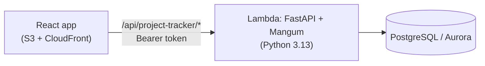

# Hexpath PT

*ACME's project tracker (PT = project tracker).* The name comes from the honeycomb: a well-planned team fits together like hexagon cells, with every person's time filled once, no gaps and no overlaps (one milestone at a time, 40 hours a week). The path is the milestones, each one leading to the next through its dependencies. Milestones are drawn as diamonds, as on a Gantt chart, and each project page opens its milestone list with the path itself: the milestones as a dependency graph, completed links solid green and pending ones dashed.

A project, milestone, resource and budget tracker for ACME Inc. Admins set up
people and projects, managers plan milestones and assign their team, and
employees log the hours they work. Every project shows up as a coloured sheet:

| Sheet | Meaning |
|---|---|
| White | In progress, within budget |
| Red | In progress, spent more than its budget |
| Green | Completed (or archived) |

An amber **At risk** flag adds the reasons: over budget, forecast over budget,
overdue milestones, past the end date, or planned hours above the estimate.

## Questions it answers

| Business question | Where |
|---|---|
| Current status of each active project | Projects page, Overview |
| Projects at risk of missing deadlines | Overview "Needs attention", Projects "At risk only" filter |
| How resources are allocated | Overview "Who is working on what", People page |
| Key deliverables and their completion | Project page, Milestones |
| Who is over-allocated | Prevented: an employee can't have overlapping assignments; availability shows as Unassigned / hours this week |
| Dependency chain between deliverables | The milestone path at the top of each project (a dependency graph), and "Waiting on …" on each milestone until its predecessors are complete |
| Budget consumed vs planned | Budget gauge on every sheet, project figures, budget history |

## Run it locally

**Option A: full workshop stack** (LocalStack Lambda + proxy + Vite)

```sh
./bin/start-dev.sh                                    # http://localhost:3000, API on :3001
python backend/project-tracker/scripts/seed_demo.py   # optional demo data
```

**Option B: fast loop with uvicorn** (only PostgreSQL needed)

```sh
cd backend/project-tracker
pip install -r requirements.txt -r requirements-dev.txt
uvicorn app:app --reload --port 3001     # API docs: http://localhost:3001/api/project-tracker/docs

cd frontend                              # second terminal
npm install
echo "VITE_API_URL=http://localhost:3001" > .env.local
npm run dev                              # http://localhost:3000
```

Use one option at a time (both use port 3001).

**Database:** the first request runs `schema.sql` if the database has no
`users` table yet, then creates the first admin. Local credentials are
`postgres` / `postgres123`, database `postgres` (from `infra/locals.tf`). If
the database still has tables from an older version of the schema, run
`backend/project-tracker/scripts/reset_db.sql` first. It deletes everything.

### Sign-in accounts

Sign in with the username **or** the email. Usernames are generated (6
random characters), so the demo accounts are easiest to use by email; the
seed script prints each generated username too.

| Role | Sign in with | Password |
|---|---|---|
| Admin (always created) | `admin` | `Admin@123` (change it on the Profile page) |
| Manager (demo data) | `maria@acme.example`, `james@acme.example` | `Demo@1234` |
| Employee (demo data) | `eve@acme.example`, `raj@…`, `lena@…`, `tom@…`, `ana@…` | `Demo@1234` |

## Deploy to AWS

```sh
./bin/deploy-backend.sh          # Lambda (FastAPI via Mangum) + Aurora + CloudFront
./bin/deploy-frontend.sh         # builds React and uploads to S3
curl https://<cloudfront-domain>/api/project-tracker/health
python backend/project-tracker/scripts/seed_demo.py https://<cloudfront-domain>   # optional
```

The health check proves the full path: CloudFront → Lambda → Aurora. The
interactive API docs are at `https://<cloudfront-domain>/api/project-tracker/docs`.

## Architecture



### Backend: `backend/project-tracker/`

The same layers as a classic FastAPI repository-pattern app:

```
function.py              Lambda entry: handler = Mangum(app)
app.py                   FastAPI app: routers, error handlers, CORS (local only), request logging
auth.py                  get_current_user and require_roles([...]) dependencies
security.py              password hashing (PBKDF2) and JWT access/refresh tokens
db.py                    connection, transaction(), init_db() (runs schema.sql once, seeds the admin)
schema.sql               the tables
models/entities.py       User -> Admin / Manager / Employee: who may do what
models/schemas.py        Pydantic request bodies
repositories/            all the SQL (users, projects, milestones + assignments, time entries, audit log)
services/                business rules; raise errors from errors.py
routers/                 thin FastAPI routes: validate, check role, call a service
scripts/seed_demo.py     demo data through the public API
scripts/reset_db.sql     development: drop everything
tests/                   test_services.py (rules, real PostgreSQL), test_api.py (HTTP layer)
```

A request goes **router → auth dependency → service → repository → SQL**,
inside one `with transaction()`: committed if everything succeeds, rolled back
on any error, so data is never half-saved.

**Permissions** live in `models/entities.py`. The base `User` class denies
everything; `Admin`, `Manager` and `Employee` override what they may do.
`require_roles` checks the role per endpoint, and the services ask the user
object about specific records (`user.can_manage_project(project)`). The UI
hides buttons using a `permissions` object from the API, but the API enforces
everything itself.

### Database (`schema.sql`)

| Table | Purpose |
|---|---|
| `users` | Everyone who can sign in: name, generated username, email, password hash, `role` (ENUM), `archived_at` |
| `employees` | Extra details for employees: title, salary, manager |
| `projects` | Title, dates, budget, estimated hours, one manager, `completed_at`, `archived_at` |
| `milestones` | Deliverables inside a project with their own dates and `completed_at`. The description is the completion criteria ("200 servers retired"); the project description holds the full instructions |
| `milestone_dependencies` | "This milestone can't start until that one is complete" (pairs of milestone IDs) |
| `milestone_assignments` | Who works on which milestone, from when to when |
| `time_entries` | Hours per employee per day, with the hourly rate at the time |
| `budget_history` | Every budget change, its reason and who made it |
| `audit_log` | Every action and sign-in (admins only) |
| `app_settings` | The secret used to sign login tokens |

**Timestamps are the flags:** `archived_at` set → archived; `completed_at`
set → completed; both `NULL` → in progress. A milestone with no
`completed_at` is "in progress" once its start date has passed, otherwise
"not started".

### Frontend: `frontend/src/`

```
services/   api.js (fetch, token refresh, errors), tracker.js (one function per endpoint), auth.jsx
lib/        router, hooks (useApi, useForm), validators, formatters
components/ ProjectSheet, BudgetGauge, Field, Modal, forms, tables
pages/      Login, Dashboard (per role), Projects, ProjectDetail, People, MyTeam, Time, AuditLog, Profile
```

Each role gets its own navigation and home page:

- **Admin:** organisation totals, every project, who is working on what, recent activity, People and Audit log.
- **Manager:** their projects, their team's availability and hours this week, milestones due in the next 2 weeks.
- **Employee:** this week's hours against 40, a quick "log today" form, current and upcoming assignments, their projects (no money shown), and My team: their manager and teammates (contact details only).

## Business rules

All of these are checked in `services/` and covered by `tests/test_services.py`.

| Rule | Where |
|---|---|
| Only admins create, archive and restore users and projects | `require_roles` + entities |
| Archive instead of delete; only admins see archives | `archived_at`; non-admins get 404 for archived records |
| Managers run only their own projects and edit only their own team (name, email, title, salary) | `Manager` class |
| Managers see salaries, rates and per-person costs only for their own team | `Manager.can_view_salary` |
| Employees see only projects they're assigned to and edit only their own name and email | `Employee` class, `PUT /auth/me` |
| Only employees have a manager, and it must be a manager | `users_service` |
| Usernames are generated (6 random characters, retried on a clash) and never change | `users_service.new_username` |
| Employees see their manager and teammates (contact details only) | `Employee.can_view_user`, `GET /users/my-team` |
| Milestone dates inside project dates; assignment dates inside milestone dates | `milestones_service` |
| **One milestone at a time per employee** (no overlapping assignments, across projects) | `milestones_service._check_overlap` |
| Completed milestones are locked: no edits, deletes, assignments or time | `ensure_milestone_open` |
| **Dependencies:** a milestone depends only on milestones in the same project, starts after they end, can't have time logged or be completed until they're complete, and loops are rejected | `milestones_service._check_dependencies` |
| Completing a milestone frees its people from tomorrow | `complete_milestone` |
| Project completes only when every milestone is complete; only completed projects can be archived | `projects_service` |
| Time: ≤ 8h a day, one entry a day, ≤ 40h a week, not in the future, only on assigned dates | `time_service` |
| Cost = hours × (salary ÷ 2,080), rate frozen when logged | `time_entries.hourly_rate` |
| Budget changes need a reason and are recorded | `budget_history` |
| Every change, sign-in and sign-out is recorded; password hashes never are. The audit page live-tails (checks every 5 s) and highlights new entries in light blue | `audit_log`, `AuditLogPage` |

**Budget and forecast:** *spent* = logged hours × each entry's rate.
*Forecast at completion* = spent + remaining assigned weekdays (from tomorrow)
× 8h × each person's rate.

## API

Everything is under `/api/project-tracker`. Full interactive docs at
`/api/project-tracker/docs`: use **Authorize** with a token from
`/auth/login`. All routes except health, login and refresh need
`Authorization: Bearer <token>`.

| Method | Path | Who |
|---|---|---|
| GET | `/health` | public |
| POST | `/auth/login`, `/auth/refresh` | public |
| POST | `/auth/logout` | all (records the sign-out in the audit log) |
| GET, PUT | `/auth/me` | all (PUT: name and email only) |
| POST | `/auth/change-password` | all |
| GET | `/dashboard` | all (content depends on role) |
| GET, POST | `/users` | admin + manager (GET), admin (POST) |
| GET | `/users/my-team` | employee |
| GET, PUT, DELETE | `/users/{id}` | admin, or a manager for their team (DELETE = archive, admin) |
| POST | `/users/{id}/restore`, `/users/{id}/reset-password` | admin |
| GET, POST | `/projects` | all (GET), admin (POST) |
| GET, PUT, DELETE | `/projects/{id}` | viewers / its manager / admin (DELETE = archive) |
| POST | `/projects/{id}/complete`, `/projects/{id}/restore` | manager, admin |
| PUT | `/projects/{id}/manager` | admin |
| GET | `/projects/{id}/budget-history` | manager, admin |
| GET, POST | `/projects/{id}/milestones` | viewers / manager |
| GET, PUT, DELETE | `/milestones/{id}` | viewers / manager |
| POST | `/milestones/{id}/complete` | manager |
| GET, POST | `/milestones/{id}/assignments` | viewers / manager |
| GET | `/assignments` | all (scoped by role) |
| PUT, DELETE | `/assignments/{id}` | manager |
| GET, POST | `/time-entries` | all (GET, scoped), employee (POST) |
| PUT, DELETE | `/time-entries/{id}` | the employee (admin may delete) |
| GET | `/audit-logs` | admin |

Status codes: 200, 201 created, 204 archived/deleted, 400 validation,
401 not signed in or expired, 403 not allowed, 404 not found, 409 conflict
(duplicate, overlap, locked record), 503 database unavailable. Every error
has the same shape (FastAPI's 422 validation errors are turned into 400):

```json
{"error": {"code": "validation_error", "message": "Please correct the highlighted fields",
           "fields": {"end_date": "Must be on or after the start date"}}}
```

## Testing

| Suite | Command | What it covers |
|---|---|---|
| Backend rules | `cd backend/project-tracker && pytest` | 70 tests in `test_services.py`: every rule above against a real PostgreSQL, in a separate `tracker_test` database |
| Backend HTTP | (same command) | 11 tests in `test_api.py`: routing, auth dependencies, 400/401/403/404/409 shapes, URL prefix handling, and a real Lambda event through Mangum |
| Frontend unit | `cd frontend && npm test` | 20 tests: formatters, router, validators, milestone graph layout, API client including token refresh |
| End to end | `cd frontend && npx playwright install chromium && npm run test:e2e` | A real browser through all three roles: admin creates people and a project, manager plans and assigns, employee logs time and sees their team, manager sees the cost |

Coverage: `pytest --cov=. --cov-report=term-missing`.

## Assumptions

- Admins create projects and pick their manager; each project has one manager.
- Only employees have a title, salary and manager. Admins and managers have no salary in the system.
- Salary is annual; hourly rate = salary ÷ 2,080 (40h × 52 weeks).
- "One milestone at a time" means an employee's assignment dates may not overlap, across all projects.
- Time can be logged for past days on assigned dates (no approval step), but not future days.
- Archiving a manager requires moving their employees and active projects to another manager first. Archiving an employee ends their current assignment today and removes future ones.

## Trade-offs

- **FastAPI on Lambda via Mangum.** Standard, readable routes and free API docs, while keeping the workshop's serverless deployment. The cost is a bigger package and slightly slower cold starts than a bare handler.
- **One Lambda with routers by feature** rather than one Lambda per entity, so auth, database and rules code is shared instead of copied.
- **Plain SQL in repositories, no ORM.** Every query is visible and readable; `schema.sql` is the single source of truth for the tables.
- **Rules in Python, not database constraints.** This keeps `schema.sql` simple to read. The trade-off is that two simultaneous requests could slip past a check like the overlap check; a database `EXCLUDE` constraint would close that gap.
- **`schema.sql` runs once, on an empty database.** Simple, but later schema changes need a manual `ALTER TABLE` or a reset; a real system would use migrations (for example Alembic).
- **PBKDF2 for passwords** (standard library, nothing compiled to break when packaging for Lambda), at 100,000 iterations because a 128 MB Lambda has little CPU. The count is stored with each hash, so it can be raised later.
- **Complete, then archive (two steps).** Completing means the work is finished and the numbers are final; archiving hides the project from day-to-day lists. Keeping them apart lets a finished project stay visible (green) for review, and lets the record show whether a project was finished or abandoned.
- **Hours are logged and also calculated.** Logged hours drive actual cost (what really happened); assignments × weekdays × 8h drive the forecast (what will happen if the plan holds).
- **Generated usernames.** 31^6 ≈ 887 million combinations: with 50,000 users a new name clashes about 1 time in 18,000, and the server simply picks again (up to 20 times). The UNIQUE constraint on `users.username` catches two simultaneous creates.
- **Tokens in localStorage**, with 30-minute access tokens and 12-hour refresh tokens. httpOnly cookies would be stronger.

## Known gaps

- No email: temporary passwords are shown once to the admin.
- No pagination on the users and projects lists (the audit log is paged).
- No overtime, holidays, part-time schedules or time-entry approvals.
- Milestone and project totals include everyone, so a milestone with one person on it implies that person's cost even to a manager from another team.
- No React component tests (React Testing Library); the end-to-end test covers behaviour instead. No load testing yet.

## Changes to workshop files

- `bin/proxy-server.js`: forwards the `Authorization` header (it was dropped, so signed-in requests failed locally), lists `Authorization` explicitly in CORS (the `*` wildcard never covers it), and fixes the unknown-endpoint check, which built `"undefined/..."` and so never returned 404.
- `frontend/package.json`: adds `prop-types` and `playwright`.

Other things noticed in the template: `frontend/eslint.config.js` imports
`eslint-plugin-react-hooks` and `eslint-plugin-react-refresh`, which aren't
in `package.json`, so `npm run lint` fails until they're installed; the docs
link to `ai-stack.md` in one place and `ai-fde.md` in another; `MONGO_PORT.`
has a stray period in the variables table; and the curl examples use
`https://localhost:3001` where the local proxy only speaks `http`.
